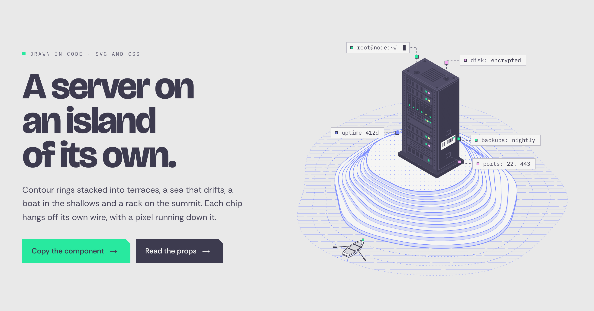
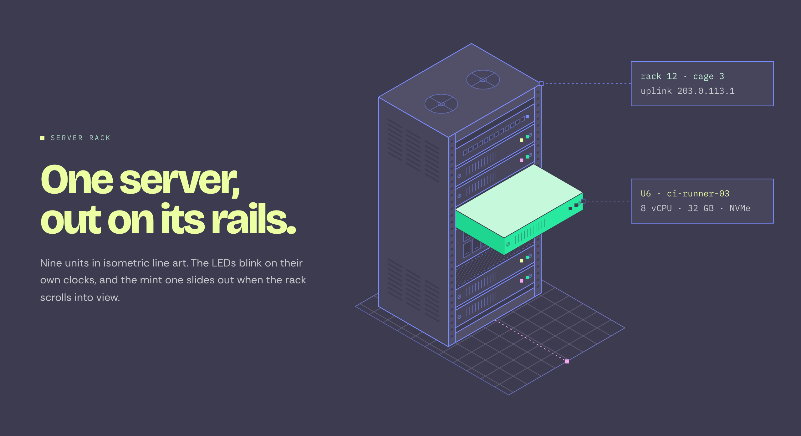
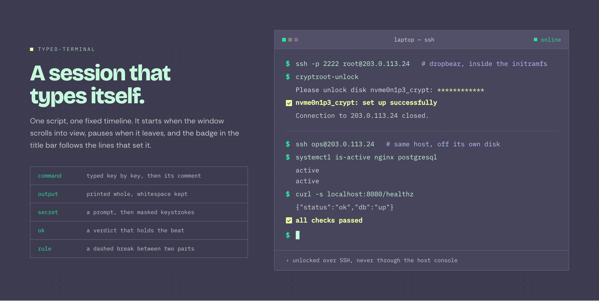
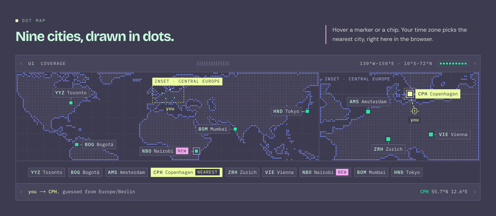
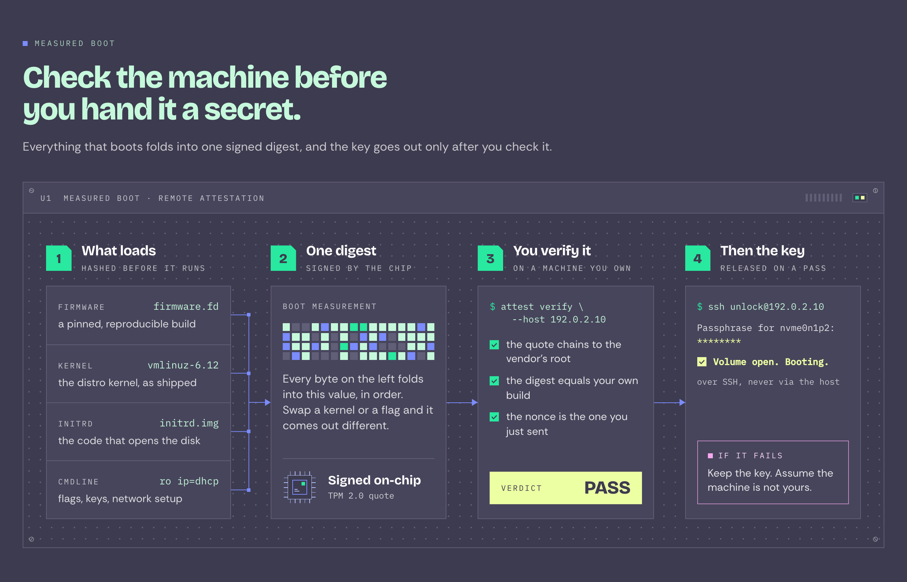
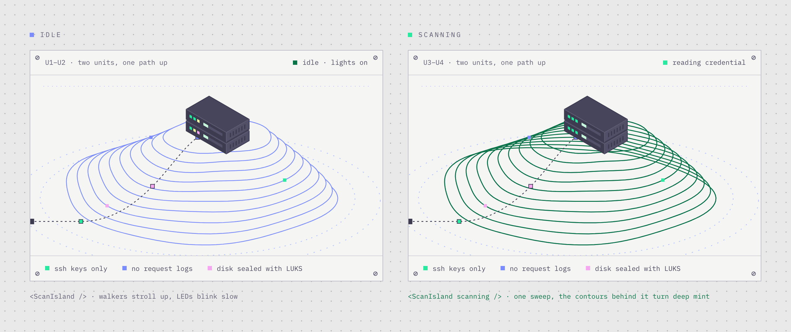
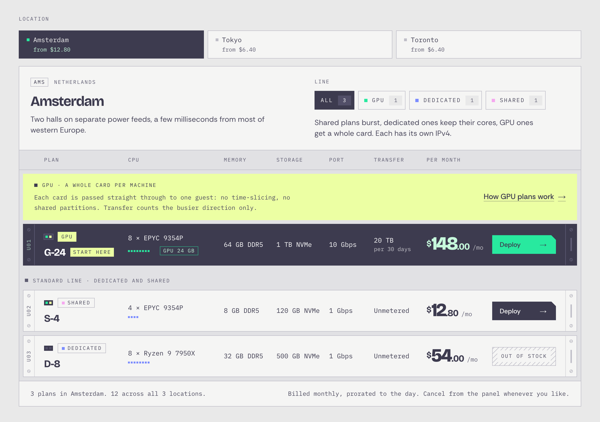
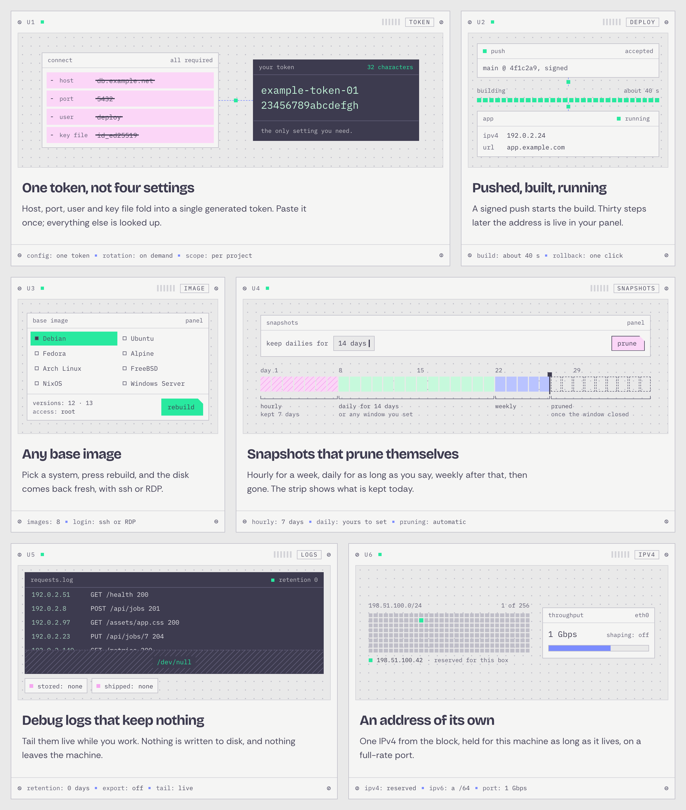
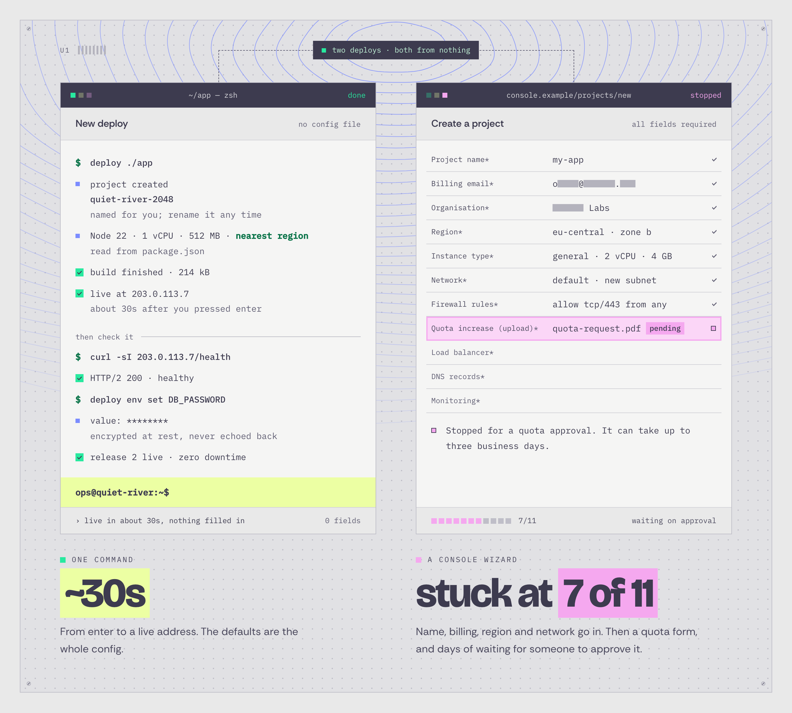
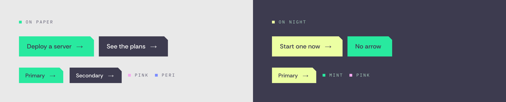

<div align="center">

<a href="https://github.com/bas3line/Components">
  <picture>
    <source media="(prefers-color-scheme: dark)" srcset="https://ascii.rest/banner/components.dark.svg?color=28e99f,7b8cff&tagline=servers%2C%20racks%20and%20maps%2C%20drawn%20in%20code">
    
  </picture>
</a>

<br>
<br>

<a href="#server-island"></a>

<br>

React components drawn in code: isometric servers, racks, terminals and maps.<br>
SVG and CSS, no images, no animation library. Copy a folder and make it yours.<br>
<sub>The map's land is the one exception: dots painted on a canvas.</sub>

[live gallery](https://bas3line.github.io/Components/) · [components](#components) · [use one](#use-one) · [run the gallery](#run-the-gallery) · [how it's built](#how-its-built) · [contributing](CONTRIBUTING.md)

[](https://github.com/bas3line)
[](https://github.com/bas3line/Components/actions/workflows/ci.yml)
[](LICENSE)
[](tsconfig.json)
[](package.json)
[](styles/tokens.css)

</div>

<br>

Written in TypeScript by [@bas3line](https://github.com/bas3line). This is where my components live from now on, starting with nine drawn for a server-hosting page: a server on an island of its own, a rack with one server out on its rails, a terminal that types itself, a chain of trust as a wiring diagram, a pricing table made of 1U blades, a world map in dots, feature cards shaped like rack units, and two windows racing each other. Every one is drawn in code and set by its own props, and every one holds still for readers who prefer reduced motion.

<p align="center">
  <a href="#server-rack"></a>
  <a href="#typed-terminal"></a>
</p>
<p align="center">
  <a href="#dot-map"></a>
  <a href="#boot-chain"></a>
</p>

## Why

I like pages that draw their own pictures. A server drawn in code is crisp at any size, takes its colours from your palette, can move a pixel down a wire, and weighs a few kilobytes instead of a stock photo's few hundred. These started on one landing page, and they were too good to leave there.

## Use one

The components are React 19 and Tailwind CSS 4, with no other dependency. Each one lives in its own folder, so you take only what you use:

1. Copy `styles/tokens.css` into your project and import it once, after Tailwind:

   ```css
   @import "tailwindcss";
   @import "./tokens.css";
   ```

2. Copy `lib/cn.ts`, and `lib/hooks.ts` if the component needs it (the table below says).
3. Copy the component's folder from `components/`.

The imports use the `@/` alias, as Next.js and shadcn projects do; in any other setup, point `@/*` at your project root in `tsconfig.json`, or change the imports to relative ones. The fonts are optional: the tokens look for [Rethink Sans](https://fonts.google.com/specimen/Rethink+Sans), [Bricolage Grotesque](https://fonts.google.com/specimen/Bricolage+Grotesque) and [IBM Plex Mono](https://fonts.google.com/specimen/IBM+Plex+Mono) in `--font-rethink`, `--font-bricolage` and `--font-plex-mono` (what `next/font` sets in `app/layout.tsx`), and fall back to the system faces.

| component | folder | also needs |
| --- | --- | --- |
| [ServerIsland](#server-island) | `components/server-island/` | `lib/cn.ts` |
| [ServerRack](#server-rack) | `components/server-rack/` | `lib/cn.ts`, `lib/hooks.ts` |
| [ScanIsland](#scan-island) | `components/scan-island/` | `lib/cn.ts`, `lib/hooks.ts` |
| [TypedTerminal](#typed-terminal) | `components/typed-terminal/` | `lib/cn.ts` |
| [BootChain](#boot-chain) | `components/boot-chain/` | `lib/cn.ts` |
| [BladeRack](#blade-rack) | `components/blade-rack/` | `lib/cn.ts`, `lib/hooks.ts`, `components/primitives/NotchButton.tsx` |
| [DotMap](#dot-map) | `components/dot-map/` | `lib/cn.ts`, `lib/hooks.ts` |
| [RackModule](#rack-modules) | `components/rack-modules/` | `lib/cn.ts` |
| [WindowRace](#window-race) | `components/window-race/` | `lib/cn.ts` |
| [NotchButton, Kicker](#primitives) | `components/primitives/` | `lib/cn.ts` |

`ServerIsland`, `ServerRack`, `RackModule` and the primitives render on the server; the rest are client components (`"use client"`), so all of them drop straight into the Next.js app router.

## Run the gallery

It's live at [bas3line.github.io/Components](https://bas3line.github.io/Components/). To run it yourself:

```sh
git clone https://github.com/bas3line/Components
cd Components
npm install
npm run dev        # http://localhost:3000
```

Node 20 or later. The gallery at `/` shows every component, and `/preview/<name>` shows one alone.

| script | |
| --- | --- |
| `npm run dev` | the gallery with hot reload |
| `npm run check` | typecheck, lint and a production build; what CI runs |
| `npm run build` | the production build |
| `npm run shots` | the README pictures, from the running gallery, into `.github/readme/` |

## Components

### server-island


An isometric island drawn in code: contour rings stacked into terraces, a sea of fine lines that drifts, a rowing boat that bobs, and a server rack on the summit with blinking LEDs. Up to five label chips hang off it on dashed wires, and a pixel runs down each wire into the rack.

```tsx
import { Dim, ServerIsland } from "@/components/server-island/ServerIsland";

<ServerIsland className="mx-auto max-w-[640px]" />

<ServerIsland
  chips={[
    { text: "deploy@edge:~$", label: "a deploy prompt", caret: true },
    { text: <><Dim>build:</Dim> green</>, label: "a green build", pixel: "lime" },
    { text: <><Dim>p99</Dim> 41ms</>, label: "41 ms p99 latency" },
  ]}
/>
```

<details>
<summary>Props</summary>

| prop | type | default | |
| --- | --- | --- | --- |
| `chips` | `IslandChip[]` | five server chips | Fill five fixed slots in order: two on the lid, one off the front, two off the side. The last two hide on phones; past five are dropped. `IslandChip` is `{ text, label?, pixel?, caret? }`: `label` is the chip in words for screen readers, `pixel` is `"mint" \| "lime" \| "pink" \| "peri"`, `caret` adds a blinking cursor. |
| `label` | `string` | built from the chips | The whole drawing's screen-reader description. |
| `className` | `string` | | On the root, a 700:620 box that fills its width. |

`Dim` sets the quieter key half of a chip, and `DEFAULT_CHIPS` is exported too.
</details>

### server-rack


A nine-unit rack in isometric line art: periwinkle edges on slate faces, LEDs as pixels, roof fans, side vents and a floor grid with a dashed uplink. When it scrolls into view the mint server slides out on its rails and two callout cards fade in. Below 520 px of width the drawing crops to the rack and the cards move under it.

```tsx
import { ServerRack } from "@/components/server-rack/ServerRack";

<div className="bg-night p-12">
  <ServerRack
    server={{ title: "U6 · ci-runner-03", detail: "8 vCPU · 32 GB · NVMe" }}
    rack={{ title: "rack 12 · cage 3", detail: "uplink 203.0.113.1" }}
  />
</div>
```

<details>
<summary>Props</summary>

| prop | type | default | |
| --- | --- | --- | --- |
| `server` | `RackCallout \| null` | `{ title: "U6 · app-01", detail: "4 vCPU · 8 GB · NVMe" }` | The card off the server that is out. `RackCallout` is `{ title, detail? }`. `null` drops the card and its leader. |
| `rack` | `RackCallout \| null` | `{ title: "rack 07 · hall B", detail: "8 of 9U · 1.4 kW" }` | The card off the roof. `null` drops it. |
| `label` | `string` | built from the cards | The screen-reader description. |
| `className` | `string` | | On the root, which fills its container's width. |
</details>

### scan-island



A two-unit server on an island of periwinkle contour lines, with one dashed path up from the water and pixel squares walking it. Set `scanning` and a mint line sweeps across once, the contours behind it turn deep mint, the LEDs go mint and the walkers hurry. Made for a sign-in screen, while a key is being read.

```tsx
import { ScanIsland } from "@/components/scan-island/ScanIsland";

<ScanIsland scanning={isChecking} label="U3–U4" notes={[{ label: "keys only", color: "mint" }]} />
```

<details>
<summary>Props</summary>

| prop | type | default | |
| --- | --- | --- | --- |
| `scanning` | `boolean` | `false` | Sweeps once and turns the contours deep mint while true. |
| `label` | `ReactNode` | `"U1–U2"` | The plate's top-left text. |
| `detail` | `ReactNode` | `"two units, one path up"` | After the label, from `sm` up. |
| `idleStatus` | `ReactNode` | `"idle · lights on"` | The top-right status while idle. |
| `scanningStatus` | `ReactNode` | `"reading credential"` | The top-right status while scanning. |
| `notes` | `{ label, color }[]` | three notes | The legend along the bottom; `color` is `"mint" \| "peri" \| "pink" \| "lime"`. An empty array removes it. |
| `ariaLabel` | `string` | a sentence | The drawing's label. |
| `className` | `string` | | On the plate. |
</details>

### typed-terminal


A terminal window that plays a scripted session once it scrolls into view: commands typed key by key, output printed whole, a passphrase typed as stars, verdicts that hold a beat, and a status badge in the title bar that changes with the lines. It pauses off screen, replays from a button, and without script or with reduced motion shows the finished session.

```tsx
import { TypedTerminal } from "@/components/typed-terminal/TypedTerminal";

<TypedTerminal
  title="ci — deploy"
  status={{ label: "building", tone: "peri" }}
  script={[
    { kind: "command", text: "make release", comment: "# tagged v2.4.0" },
    { kind: "output", text: "built 14 targets in 38s" },
    { kind: "ok", text: "deployed to 198.51.100.12", status: { label: "live", tone: "mint" } },
  ]}
  className="max-w-[640px]"
/>
```

<details>
<summary>Props</summary>

| prop | type | default | |
| --- | --- | --- | --- |
| `script` | `TerminalLine[]` | an ssh unlock session | The lines, each one of: `{ kind: "command", text, comment? }` typed after the prompt; `{ kind: "output", text }` printed whole; `{ kind: "secret", prompt, keys? }` a prompt, then masked keys (8 by default); `{ kind: "ok", text }` a verdict that holds; `{ kind: "rule" }` a dashed break. Every line but a rule also takes `status?` to switch the badge and `pause?` in ms. |
| `title` | `string` | `"laptop — ssh"` | Centred in the title bar. |
| `status` | `Badge \| null` | `{ label: "locked", tone: "pink" }` | The badge before any line changes it. `Badge` is `{ label, tone? }`. |
| `note` | `ReactNode` | a line | The footer beside the replay button. |
| `prompt` | `string` | `"$"` | The glyph before each command. |
| `caption` | `string` | built from the script | What screen readers hear in place of the animation. |
| `className` | `string` | | On the outer figure. |

`DEFAULT_SCRIPT` is exported.
</details>

### boot-chain


A chain of trust drawn as a wiring diagram on a rack panel: inputs gathered onto one bus, then numbered stages with a hash drawn as pixels, a chip, a command with ticked checks, a lime PASS and a pink "if it fails" note. Mint pixels run the wires one after another while it is on screen. It lays itself out by its own width, side by side from 72rem and stacked below.

```tsx
import { BootChain } from "@/components/boot-chain/BootChain";

<BootChain
  caption="release pipeline"
  inputs={[
    { label: "Source", value: "main@3f2a", note: "the tagged commit" },
    { label: "Lockfile", value: "lock.json", note: "pinned deps" },
  ]}
  stages={[
    { title: "One digest", where: "signed by the builder", hash: 7, chip: { title: "Signed on-chip", detail: "HSM key" } },
    { title: "You verify it", where: "before deploy", command: "verify --artifact app.tar", checks: ["signature is valid"], verdict: { value: "PASS" } },
  ]}
/>
```

<details>
<summary>Props</summary>

| prop | type | default | |
| --- | --- | --- | --- |
| `inputs` | `{ label, value, note? }[]` | firmware, kernel, initrd, cmdline | The rows gathered onto the bus. Any count. |
| `inputsTitle` | `string` | `"What loads"` | The inputs column's title. |
| `inputsWhere` | `string` | `"hashed before it runs"` | The line under it. |
| `stages` | `BootChainStage[]` | digest, verify, key | Each takes `title` and `where`, then any of `label`, `hash` (a seed for the pixel hash), `command`, `output`, `ok`, `aside`, `body`, `checks`, and at its foot `chip { title, detail }`, `verdict { label?, value }` or `warn { title, body }`. Any count; the cycle stretches so runners never overlap. |
| `tag` | `string` | `"U1"` | At the left of the header strip. |
| `caption` | `string` | `"measured boot · remote attestation"` | In the header strip, from 36rem wide. |
| `label` | `string` | `"Boot chain, step by step"` | The steps list's label. |
| `className` | `string` | | On the root, which needs a parent that gives it a width. |
</details>

### blade-rack



A pricing table drawn as a rack cabinet. Every plan is a 1U blade with screwed ears, a unit number, LEDs, a tag, a pixel map of its cores, specs, a big price and a notched button. Tabs switch location (arrow keys, Home and End), a filter picks a product line, featured lines rack first as slate blades, sold-out plans go dark behind a hatched plate, and a line not sold in a place shows an empty bay that offers the places that have it. `variant="tiers"` racks the plans as tall blades between punched rails instead.

```tsx
import { BladeRack } from "@/components/blade-rack/BladeRack";

<BladeRack />  {/* the bundled sample */}

<BladeRack
  groups={[{ id: "ams", name: "Amsterdam", code: "AMS", region: "Netherlands", plans: [
    { id: "s4", name: "S-4", line: "shared", price: 12.8,
      specs: { cpu: { value: "4 × EPYC 9354P", cores: 4 }, ram: "8 GB DDR5" } },
  ] }]}
  lines={[{ id: "shared", name: "Shared", pixel: "pink" }]}
  columns={[{ key: "cpu", label: "CPU" }, { key: "ram", label: "Memory" }]}
  variant="tiers"
/>
```

<details>
<summary>Props</summary>

| prop | type | default | |
| --- | --- | --- | --- |
| `groups` | `BladeGroup[]` | three sample locations | One tab each: `{ id, name, code?, region?, note?, plans }`. A plan is `{ id, name, line, specs, price, period?, href?, inStock?, tag?, detail? }`. The tabs hide with one group. |
| `lines` | `BladeLine[]` | from the plans | One filter chip each: `{ id, name, pixel?, note?, featured?, tagline?, band?, link? }`. Featured lines rack first. The filter hides with one line. |
| `columns` | `BladeColumn[]` | from the first plan | The spec columns: `{ key, label, track?, unit? }`. The first is the wide one, with room for the core map. |
| `variant` | `"rows" \| "tiers"` | `"rows"` | One-line blades on paper, or tall slate blades between rails. |
| `defaultGroup` | `string` | the first | The tab to open on. |
| `defaultLine` | `string` | all | The line to open filtered to. |
| `allNote` | `ReactNode` | | Under the filter while it shows every line. |
| `terms` | `ReactNode` | | The footer's right half. |
| `currency` | `string` | `"$"` | Before every price. |
| `period` | `{ short, long }` | `/mo`, per month | After prices, and read to screen readers. |
| `labels` | `Partial<BladeLabels>` | English | Every word of the UI. |
| `className` | `string` | | On the root. |
</details>

### dot-map


A world map drawn as a dot lattice on a slate faceplate: periwinkle at the coast, quieter inland, mint pins whose square rings breathe, labelled chips that keep out of each other's way, and an enlarged inset for a crowded area. It guesses the reader's nearest pin from their time zone, in the browser, with no IP lookup and no location prompt, and draws a dashed line from "you" to it. Hover or click a pin, or use the row of chips under the map with the keyboard.

```tsx
import { DotMap } from "@/components/dot-map/DotMap";

<DotMap
  title="Edge"
  pins={[
    { id: "sel", code: "ICN", label: "Seoul", lat: 37.57, lon: 126.98 },
    { id: "osa", code: "KIX", label: "Osaka", lat: 34.69, lon: 135.5, tag: "Edge" },
    { id: "tpe", code: "TPE", label: "Taipei", lat: 25.03, lon: 121.57 },
    { id: "den", code: "DEN", label: "Denver", lat: 39.74, lon: -104.99 },
  ]}
  inset={{ label: "East Asia", bounds: { west: 115, east: 145, north: 45, south: 20 } }}
  onPick={(id) => console.log(id)}
/>

// The guess on its own, in the browser:
import { guessNearest } from "@/components/dot-map/guess";
```

<details>
<summary>Props</summary>

| prop | type | default | |
| --- | --- | --- | --- |
| `pins` | `DotMapPin[]` | nine sample cities | `{ id, label, lat, lon, code?, tag?, sides? }`. Pins inside the map's crop (130°W–150°E, 10°S–72°N) are drawn. `tag` adds a pink tag; `sides` sets where its chip tries to go first. |
| `inset` | `DotMapInset \| null` | Central Europe with the samples, none with your pins | `{ label, bounds: { west, east, north, south }, center? }`. Pins inside the bounds move to the inset. |
| `guess` | `boolean` | `true` | Guess the nearest pin from the reader's time zone. |
| `rules` | `Record<string, string>` | | Send a zone (`"Asia/Dubai"`) or a whole area (`"Africa"`) to a pin id, whatever the distance. |
| `timeZone` | `string` | the reader's | Guess for this IANA zone instead. |
| `initial` | `string` | the first pin | The pin in focus before a guess or a pick. |
| `title` | `string` | `"Coverage"` | The faceplate's title. |
| `onPick` | `(id: string) => void` | | Called when a pin is picked. |
| `className` | `string` | | On the root. |

The land comes from [Natural Earth](https://www.naturalearthdata.com) (public domain), encoded in `worldmask.ts`.
</details>

### rack-modules



Feature cards drawn as rack units: screwed ears, a U number, a blinking LED, vents, a tag, a sunken dot-lattice face, a title, a line of copy and a spec strip. Six faces come ready, each a small UI mock-up in periwinkle line art and pixels that loops in CSS: a form folding into a token, a build bar filling, a picker cycling, a today marker walking a strip of days, a log draining into `/dev/null`, and an address with its throughput. Each face is a size container, so it lays itself out for the card it sits in.

```tsx
import { RackModule, TimelineFace, TokenFace } from "@/components/rack-modules/RackModule";

<RackModule />

<RackModule
  unit={4}
  tag="snapshots"
  title="Snapshots that prune themselves"
  body="Hourly for a week, daily for as long as you say, then gone."
  spec={["hourly: 7 days", "daily: yours to set"]}
  face={<TimelineFace value="30 days" />}
/>

<RackModule face={<TokenFace token="example-token-0123456789abcdefgh" />} />
```

<details>
<summary>Props</summary>

| prop | type | default | |
| --- | --- | --- | --- |
| `unit` | `number` | `1` | The U number. It also turns the screws and sets the LED's phase. |
| `tag` | `string` | `"deploy"` | The tag in the upper ear. |
| `title` | `ReactNode` | a title | The heading under the face. |
| `body` | `ReactNode` | a sentence | The copy under the title. |
| `spec` | `string[]` | two specs | The strip in the lower ear; in `"key: value"` the value prints darker. |
| `face` | `ReactNode` | `<DeployFace />` | The drawing: `TokenFace`, `DeployFace`, `PickerFace`, `TimelineFace`, `DrainFace`, `AddressFace`, or your own inside a `RackFace`. Each face takes props for its content. |
| `titleAs` | `"h2" \| "h3" \| "h4"` | `"h3"` | The title's heading level. |
| `className` | `string` | | On the article; other article attributes pass through. |
</details>

### window-race



Two app windows racing from the same start on a screwed-down stage with contour rings behind. Each plays a script on fixed CSS timelines: a transcript types commands, prints values that mask themselves, fills progress bars and lands on a ready prompt; a form types into its fields, uploads, and can stop for good at one row, which turns pink. It plays on screen, pauses off it, and a replay button restarts both.

```tsx
import { WindowRace } from "@/components/window-race/WindowRace";

<WindowRace />

<WindowRace
  start="two releases · same commit"
  windows={[
    { kind: "transcript", title: "~/api — zsh", heading: "Ship it",
      lines: [{ kind: "command", text: "ship ." }, { kind: "wait", text: "building…", done: "live at 198.51.100.4" }],
      done: "ops@api:~$", caption: { name: "the fast lane", mark: "~20s", text: "One command." } },
    { kind: "form", title: "portal.example/release", heading: "Release request",
      fields: [{ label: "Ticket", value: "REL-1182" }, { label: "Sign-off (upload)", value: "approval.pdf", upload: "uploading", tag: "in review" }],
      stallAt: 1, notice: "Waiting on sign-off.",
      caption: { name: "the slow lane", lead: "stuck at", mark: "1 of 2", text: "Then a review queue." } },
  ]}
/>
```

<details>
<summary>Props</summary>

| prop | type | default | |
| --- | --- | --- | --- |
| `windows` | `[RaceWindow, RaceWindow]` | a one-command deploy against an eleven-field wizard | Left, then right. Each is a transcript, `{ kind: "transcript", lines, prompt?, done? }`, or a form, `{ kind: "form", fields }`, plus `title`, `heading`, `note?`, `stallAt?` (where it stops for good), `notice?`, `foot?` and `caption { name, lead?, mark, text }`. Transcript lines are `command`, `info`, `wait`, `ok`, `secret` or `rule`. |
| `start` | `string \| null` | `"two deploys · both from nothing"` | The chip over both windows. `null` removes it and its connectors. |
| `label` | `string` | `"U1"` | The stage's mark, top left. |
| `caption` | `string` | built from the windows | What screen readers hear in place of the animation. |
| `className` | `string` | | On the outer figure. |
</details>

### primitives



The two small pieces the others are built with. `NotchButton` is a flat block with its top-right corner cut, a link when it has an `href` and a button when it doesn't. `Kicker` is the mono label over a heading, with one lit pixel.

```tsx
import { Kicker } from "@/components/primitives/Kicker";
import { NotchButton } from "@/components/primitives/NotchButton";

<Kicker pixel="pink">Drawn in code</Kicker>
<NotchButton href="/deploy" size="lg">Deploy a server</NotchButton>
<NotchButton tone="ink" onClick={open}>See the plans</NotchButton>
```

<details>
<summary>Props</summary>

| component | prop | type | default |
| --- | --- | --- | --- |
| `NotchButton` | `tone` | `"mint" \| "ink" \| "lime"` | `"mint"` |
| | `size` | `"md" \| "lg"` | `"md"` |
| | `arrow` | `boolean` | `true` |
| | `href` | `string` | none, so a `<button>` |
| `Kicker` | `tone` | `"paper" \| "night"` | `"paper"` |
| | `pixel` | `"mint" \| "lime" \| "pink" \| "peri"` | `"mint"` |
</details>

## How it's built

```
components/
  <name>/            one component, and everything it needs; copy it alone
  primitives/        NotchButton and Kicker
lib/
  cn.ts              joins class names
  hooks.ts           useInView, usePrefersReducedMotion
styles/
  tokens.css         the palette as CSS variables and Tailwind tokens, plus .notch, .bg-dots, .bg-hatch
demos/<name>.tsx     each component dressed for its picture
app/                 the gallery (/) and one page per component (/preview/<name>)
registry.ts          the list the gallery shows
scripts/shoot.mjs    takes the README pictures with Playwright
.github/workflows/
  ci.yml             typecheck, lint and build on every pull request
  pages.yml          the gallery as a static export, deployed to GitHub Pages from main
```

React 19, Tailwind CSS 4, TypeScript, and Next.js for the gallery. The drawings are SVG with their geometry computed in code, except the map's land, which is dots painted on a canvas. The motion is CSS keyframes: seven of the nine ship theirs inside the component as a React 19 `<style>`, which lands in the head once however many copies are on the page, and `blade-rack` and `dot-map` use the ones in `tokens.css`. Nothing is random at render, so the server and the browser draw the same picture. Example addresses come from the documentation ranges, and every product, plan and price in the demos is made up.

## Contributing

New components, fixes and ideas are welcome. [CONTRIBUTING.md](CONTRIBUTING.md) covers the setup, how a component is laid out, the rules they follow and how to open a pull request, and the [code of conduct](CODE_OF_CONDUCT.md) applies everywhere. Found a security problem? See [SECURITY.md](SECURITY.md).

## Author

Made by [@bas3line](https://github.com/bas3line). If you use one, a link back is appreciated, and so is a star.

To support it: [GitHub Sponsors](https://github.com/sponsors/bas3line), [Buy Me a Coffee](https://buymeacoffee.com/bas3line) or [PayPal](https://paypal.me/ShubhamYadav886).

## License

MIT, © [@bas3line](https://github.com/bas3line)
